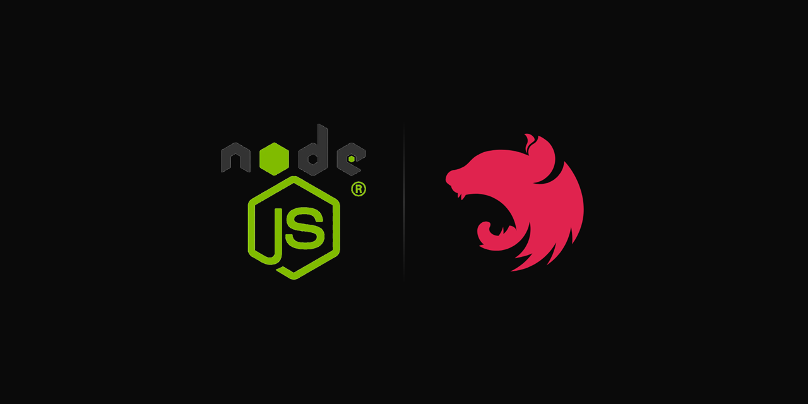

---

# 🐈 Stack Backend del Proyecto
A continuación se resumen las principales tecnologías del proyecto y el motivo por el que se utilizan. No se incluyen todas las dependencias.

## 🟢 Node.js 24.22.1

## [Nest.js 12](https://youtu.be/wsqcg5ZtUMM?si=o0rmZsPYwMlrl7Ed)
_Framework semi-opinionado_ que combina la _arquitectura modular de Angular_ con la _flexibilidad de Express.js_, ofreciendo estructura escalable, soporte nativo de TypeScript e _inyección de dependencias_, y fácil integración con _ORMs_, _GraphQL_ y _microservicios_ para _APIs_ empresariales robustas.

## [TypeScript 7](https://youtu.be/fUgxxhI_bvc?si=rRY7NTzsONRSwyNN)
Agrega _tipado estático_ al lenguaje, permitiendo detectar errores durante el desarrollo y mejorar el _autocompletado_, la _refactorización_ y el _mantenimiento del código_. Además, permite tener el mismo lenguaje de programación en frontend y backend.

## [Prisma ORM 7](https://youtu.be/vUcNydH1tz0?si=mc11vxHJpcCs_5Qj)
Prisma se basa en un _esquema declarativo_ (_`schema.prisma`_) como _única fuente de verdad_, que genera un _cliente tipado_ y sincroniza la base de datos mediante _migraciones versionadas_. A diferencia de _TypeORM_, donde entidades y base de datos pueden desincronizarse, Prisma garantiza consistencia explícita entre _esquema_ y BD, con _type-safety_ en _tiempo de compilación_ que reduce _errores de mapeo_.

## [nestjs-zod](https://youtu.be/bUzGfrjg66M?si=PqQtfsXKDVA0HnuP)
Permite utilizar la _misma sintaxis de código_ y reutilizar los mismos _esquemas de validación_ en frontend y backend de Node.js. Además, se integra con _TypeScript_, ofrece validación de tipos en _tiempo de compilación_ y validación de datos en _tiempo de ejecución (runtime)_. En frontend valida _formularios_ y _datos de entrada_, con integración con _React Hook Form_ (React) y [_Forms with Signals_ (Angular)](https://angular.dev/guide/forms/signals/validation). En backend valida _`body`_, _`query`_ y _`params`_ de las _solicitudes http_, garantizando la integridad de los datos antes de procesarlos.

## PostgreSQL 18
_Base de datos relacional (RDBMS)_ con _cumplimiento ACID_, _integridad referencial_ y soporte nativo para tipos avanzados como _JSONB_, que permite almacenar y consultar documentos _JSON_ de _forma binaria_ e _indexada_, ofreciendo _flexibilidad de esquema similar a MongoDB_ sin sacrificar las _transacciones_ y _relaciones_ propias de un _modelo relacional_. Es ampliamente adoptado hoy en día por su madurez, extensibilidad (extensiones como _PostGIS_, _pgvector_), rendimiento en _cargas mixtas (OLTP)_ y compatibilidad total con _Prisma_ y el ecosistema _TypeScript_.

## DBeaver
_Cliente universal de bases de datos (GUI)_ que permite explorar, consultar y administrar la base de datos PostgreSQL de forma visual, sin escribir SQL manualmente para tareas básicas. Facilita inspeccionar tablas, ejecutar _queries_, revisar _relaciones_ y datos generados por las _migraciones de Prisma_, agilizando el _debugging_ y la validación durante el desarrollo.

> [!TIP]
> # 🧠 **Aprende**

* 🎥 Puedes hacer clic en el nombre de cada tecnología para ver cursos y aprenderlas

* [Leer esto](#nestjs-conventions) para entender la arquitectura del proyecto.

* [🔗 Enlace - HTTP Cats - Explicación de los Status HTTP](https://http.cat/)

* 🔗 Mira estos enlaces para que aprendas de IA enfocada en desarrollo de software:
1. [Ollama: IA local gratis](https://youtu.be/p2zZ6zuaCDM)
2. [Spec Driven Development](https://www.youtube.com/watch?v=_jJJDQOXSxM)
3. [Categorización de los tipos de IA: Modelos, Harnesses y Orquestadores](https://youtu.be/_HxDbdItVcs?si=VB6SHcZB1enB2Qvl)
4. [Mejores Modelos de IA](https://youtu.be/EPz00z1ACPc?si=Dkw3zECIk1d84YxX)
5. [Mejores Harnesses de IA](https://youtu.be/Fzn9uWRRDXM?si=NJJmsOYuzTXl_aad)
6. [Mejores Orquestadores de IA](https://youtu.be/rANNn5fIVmg?si=RxFAUjPUEYzXJpbq)
7. [Desarrollo de software con IA: MCP, CLI, RAG](https://youtu.be/sn1o1Hr1pJs)

# ⬇️ Instalaciones

## Instalaciones Necesarias
Esto es obligatorio, sin esto no puedes ejecutar el proyecto

> # ⚠️ Advertencia
> La forma correcta de instalar es:
> 1. Ejecutar Power Shell como administrador
> 2. El orden de instalacion es: `pnpm`, despues Node.js y de ultimo `npm`
> 3. Instalar Node.js y npm desde pnpm. **NO** uses el [instalador de Node.js](https://nodejs.org/es/download)
> 4. [**NO** instales un administrador de versiones para Node.js (fnm, nvm, volta, etc)](#instalar-fnm-opcional)
> Sino haces esto asi entonces el proyecto queda mal configurado, todo esto se explica a continuacion y en orden

### [📦 Instalar `pnpm` (Manejador de Paquetes)](https://youtu.be/MZ6JxWWCA5M?si=Ms3yvVtPOh3k4111)
Usar `pnpm` version `>=12.0.0 <13.0.0`, `pnpm-lock.yaml` y `pnpm dlx <paquete>`. Esta 🚫 **BLOQUEADO** el uso de:

* Otras versiones de `pnpm` fuera de ese rango (por ejemplo pnpm 11 o pnpm 13).

* Otros manejadores de paquetes como:

| Concepto ⬇️ / Nombre manejador de paquetes ➡️            | `npm`                                   | `yarn`                              |
| --------------------------------------------------------- | --------------------------------------- | ----------------------------------- |
| Lockfile                                                  | `package-lock.json`                     | `yarn.lock`                         |
| Ejecutar un paquete temporal (sin instalarlo globalmente) | `npx <paquete>`<br>`npm exec <paquete>` | `yarn dlx <paquete>` *(Yarn Berry)* |

Para esto en `package.json` se agrego:

```JSON
{
  "packageManager": "pnpm@12.11.2",
  "devEngines": {
    "packageManager": {
      "name": "pnpm",
      "version": ">=12.0.0 <13.0.0",
      "onFail": "download"
    }
  }
}
```

1. Ejecutar Power Shell como administrador

2. Instalar la ultima version estable de `pnpm` y agregar `pnpm` a la variable de entorno PATH

```console
irm https://get.pnpm.io/ps1 | iex
```

3. Cerrar y volver abrir Power Shell como administrador

4. Si la instalacion de pnpm es correcta, al ejecutar

```console
pnpm -v
```

Debe mostrar un numero con la version de `pnpm` instalada

5. Hacer que Windows Defender no bloquee el acceso de `pnpm`

```console
$pnpmExe = Get-ChildItem "$env:LOCALAPPDATA\pnpm" -Recurse -Filter pnpm.exe -ErrorAction SilentlyContinue | Select-Object -ExpandProperty FullName; if ($pnpmExe) { Add-MpPreference -ControlledFolderAccessAllowedApplications $pnpmExe; $pnpmExe } else { "No se encontro pnpm.exe en $env:LOCALAPPDATA\pnpm" }
```

### 🟢 Instalar Node.js (Entorno de Ejecución)
Usar Node.js, prohibido usar alternativas como:

* [Bun](https://youtu.be/9gM7HQ7SafE)
* [Deno](https://youtu.be/tOoEGrqL9_s)

1. Instalar Node.js de forma global con `pnpm`, sin depender de fnm, nvm, etc

```console
pnpm runtime set node 24.22.1 -g
```

2. Cerrar y volver abrir Power Shell como administrador

3. Si la instalacion de Node.js es correcta, al ejecutar

```console
node -v
```

Debe mostrar un numero con la version de Node.js instalada

### 📦 Instalar `npm` (Manejador de Paquetes)
1. Instalar `npm` a traves de `pnpm`

```console
pnpm add -g npm
```

2. Cerrar y volver abrir Power Shell como administrador

3. Si la instalacion de `npm` es correcta, al ejecutar

```console
npm -v
```

Debe mostrar un numero con la version de `npm` instalada

### Instalar PostgreSQL 18 (Base de Datos)
1. [Clic en este enlace](https://www.postgresql.org/download/)

2. Descargar y ejecutar el instalador

### Instalar DBeaver (Administrador de Base de Datos)
1. [Clic en este enlace](https://dbeaver.io/download/)

2. Descargar y ejecutar el instalador

### Instalar Postman
1. [Clic en este enlace](https://www.postman.com/downloads/)

2. Descargar y ejecutar el instalador

### Instalar Git Bash

> [!CAUTION]
> # ⚠️ Advertencia
> Es importante hacer esto, porque saltarse estos pasos elimina las [configuraciones de IA de este proyecto](#compatibilidad-de-este-proyecto-con-múltiples-harness-y-modelos-de-ia)

[Clic aqui para **aprender** Git Bash](https://youtu.be/niPExbK8lSw?si=gQCFLrUmqHHV-rCLy)

1. [Clic aqui para **instalar** Git Bash](https://git-scm.com/install/windows)

2. Abrir Git Bash

3. Abrir la carpeta donde se quiere descargar el proyecto

#### Configurar Usuario y Correo de Git
4. Configurar usuario de Git

```console
git config --global user.name "nombre_de_usuario"
```

5. Verificar que se configuro usuario de Git

```console
git config --global user.name
```

6. Configurar correo de Git

```console
git config --global user.email correo@gmail.com
```

7. Verificar que se configuro correo de Git

```console
git config --global user.email
```

#### Configurar Enlaces Simbolicos de Git
8. En Windows activar el modo desarrollador:
   * Abrir inicio
   * Buscar **Configuración**
   * Clic en **Sistema**
   * Clic en **Avanzado**
   * Activar la opcion que dice **Modo para desarrolladores**

   Tambien sirve si ejecutas en PowerShell como administrador:

   ```console
   reg add "HKLM\SOFTWARE\Microsoft\Windows\CurrentVersion\AppModelUnlock" /t REG_DWORD /f /v AllowDevelopmentWithoutDevLicense /d 1
   ```

9. Activar enlaces simbolicos de Git

```console
git config --global core.symlinks true
```

10. Clonar (descargar) el repositorio. Reemplazar la URL del repositorio

```console
git clone -c core.symlinks=true https://github.com/NOMBRE_USUARIO/NOMBRE_REPOSITORIO.git
```

11. Entrar a la carpeta raiz del proyecto

```console
cd /ruta/a/carpeta/raiz/del/proyecto
```

12. Verificar que los enlaces simbolicos funcionen:

```console
ls -la .claude
```

Debe mostrar `.claude -> .agents/`. Si en cambio muestra un archivo normal, o si clonaste el repositorio sin seguir estos pasos, elimina la carpeta del proyecto y repite todos los pasos 2, 3 y [8 hasta 12](#configurar-enlaces-simbolicos-de-git)

### Editor de Codigo (IDE)
Instalar [VS Code](https://code.visualstudio.com/download) o cualquier editor basado en VS Code ([Antigravity IDE](https://antigravity.google/product/antigravity-ide), [Cursor](https://cursor.com/download), etc.)

#### ⌨️ Autocompletado, Formatear Código y Linter
Usar VS Code o cualquier editor basado en VS Code para instalar las siguientes extensiones:

* [ESLint](https://marketplace.visualstudio.com/items?itemName=dbaeumer.vscode-eslint)

* [Error Lens](https://marketplace.visualstudio.com/items?itemName=usernamehw.errorlens)

* [EditorConfig](https://marketplace.visualstudio.com/items?itemName=EditorConfig.EditorConfig)

* [Prettier - Code formatter](https://marketplace.visualstudio.com/items?itemName=esbenp.prettier-vscode)

* [Console Ninja](https://marketplace.visualstudio.com/items?itemName=WallabyJs.console-ninja)

* [Path Intellisense](https://marketplace.visualstudio.com/items?itemName=christian-kohler.path-intellisense)

* [Auto Import](https://marketplace.visualstudio.com/items?itemName=steoates.autoimport)

No es necesario buscar cada extensión manualmente en el marketplace de VS Code porque el archivo `.vscode/extensions.json` ya está configurado con esas extensiones como recomendadas. Al abrir el proyecto, VS Code mostrará una notificación sugiriendo instalarlas; también puede instalarlas desde la pestaña **Extensions** filtrando por `@recommended`.

La configuración de autocompletado, formateo de código y linter ya está incluida en los siguientes archivos. No es necesario realizar modificaciones adicionales:

* `.vscode/`
* `.editorconfig`
* `.prettierrc`
* `eslint.config.js`

### Harness de IA desde la Terminal

> [!CAUTION]
> # ⚠️ **IMPORTANTE** 🚨
>
> Ignorar esta sección ocasionará que la IA genere código que no respeta la arquitectura, estructura ni las convenciones del proyecto, produciendo código legacy, inconsistente, desordenado y con malas practicas

**¿Qué es el Harness Engineering y por qué mejora los resultados de la IA?:**
[Mira este video](https://youtu.be/DOgIFhpndW0?si=k5ulr68LgZt4MumG) que responde la pregunta.

Software que envuelve al modelo y lo convierte en un sistema útil. Gestiona el bucle de ejecución: construye el prompt (instrucciones de sistema, contexto, historial), le da herramientas (leer o escribir archivos, ejecutar comandos, buscar en la web), ejecuta las acciones que el modelo pide, le devuelve los resultados y repite hasta terminar la tarea. Un buen harness permite obtener resultados más fiables incluso con el mismo modelo.

Por eso, se recomienda usar herramientas de IA desde la terminal, como las de la columna [Terminal / Bash / CLI](#principales-ia-para-desarrollo-de-software): Claude Code, Codex CLI, etc.

### Principales IA para Desarrollo de Software
Esta tabla cambia mucho, para tener informacion actualizada abre este enlace de [benchmark de IA de artificial analysis](https://artificialanalysis.ai/)

| Empresa ⬇️ / Plataforma ➡️  | Web                                                                                     | Desktop                                                               | Terminal / Bash / CLI                                                                  |
| ---------------------------- | --------------------------------------------------------------------------------------- | --------------------------------------------------------------------- | -------------------------------------------------------------------------------------- |
| Anthropic                    | [Claude Web](https://claude.ai/)                                                        | [Claude Desktop](https://youtu.be/DYwZy7VNKws?si=cXTPumpZ3Jr9rNn9)    | [Claude Code](https://youtu.be/Bf7hfpItrDk?si=wjUIcIgtDX_Loyey)                        |
| Open AI                      | [Chat GPT](https://chatgpt.com/)                                                        | [GPT Codex Desktop](https://youtu.be/bgx8ownl3O4?si=TzbOntfYIBVN1PGU) | [Codex CLI](https://youtu.be/Ub-K1n4YYsg?si=EoIXGCzEa4ZxyRqA)                          |
| Google                       | [Google AI Studio](https://aistudio.google.com/) / [Gemini](https://gemini.google.com/) | [Antigravity 2.0](https://antigravity.google/product/antigravity-2)   | [Antigravity CLI](https://youtu.be/bdEqIchP4x4?si=gRf6iLggXuzy_cq)                     |
| Anomaly Innovations          | [`opencode web`](https://opencode.ai/docs/web/)                                         | [Open Code Desktop](https://youtu.be/_SVSv2Y59P0?si=LT2S0z10t1FBxlB6) | [Open Code CLI](https://youtu.be/2gO8WyctqMk?si=aNvHlf23tKfrN-Z3)                      |
| Cursor                       | [Cursor Web](https://cursor.com/agents)                                                 | [Cursor Desktop](https://youtu.be/XWsOQTqVl0w?si=0OVGRnYSCH46v2zf)    | [Cursor CLI](https://cursor.com/es/cli)                                                |
| xAI                          | [Grok Web](https://grok.com/)                                                           | [Grok Desktop](https://youtu.be/Soec3__wdTQ?si=DDx206q48bfzxsnU)      | [Grok Build](https://youtu.be/ya35W4R6wU0?si=dBaoGmGGCdnOtKJx)                         |
| Basic Technology Research Co | [DeepSeek Web](https://chat.deepseek.com/)                                              | [DeepSeek Desktop](https://www.deepseek.com/en/download/)             | [DeepCode CLI](https://api-docs.deepseek.com/quick_start/agent_integrations/deepcode/) |
| Microsoft                    | [GitHub Copilot web](https://github.com/copilot)                                        | [GitHub Copilot Desktop](https://youtu.be/qGXVeWw7vz8)                | [GitHub Copilot CLI](https://youtu.be/SmQE6HazA38)                                     |

#### ✏️ Edición de Código
Este proyecto esta configurado para usar IA de pago y desde la terminal. **NO** sirve si usas IA gratis o desde una pagina web, porque estan limitadas.

**Razones:**
* Si copias y pegas codigo desde plataforma web al proyecto, es probable que cometas errores

* Las IAs de pago y desde la terminal tienen mejoras respecto a otras plataformas (_harness engineering_):
  * Mayor comprensión del proyecto y de la estructura completa del código (_contexto_ y _tokens_).

  * Acceso al sistema operativo (archivos y carpetas) y capacidad para ejecutar comandos.

  * Capacidad para realizar cambios respetando la arquitectura del proyecto.

  * Uso de Skills y MCP para reducir las _alucinaciones_ de la IA, permitiéndole a la IA consultar documentación oficial actualizada y seguir buenas prácticas.

## Instalaciones Recomendadas
Son opcionales. Puedes ejecutar el proyecto sin ellas, pero te ayudarán a programar mejor.

### Herdr
* [Click aqui para **instalar** Herdr](https://herdr.dev/docs/install/)

* [Click aqui para **aprender** Herdr](https://youtu.be/Hr693AAnCV0)

Tambien sirve alternativas como [Orca](https://youtu.be/ze7AgvWfRwM?si=MnVb42vL8hfvD1KO)

### [Instalar `fnm` (Opcional)](https://github.com/Schniz/fnm)

> [!NOTE]
> **NO** es necesario realizar este paso.

La razon de porque existe:
- Este paso de instalar fnm

- El archivo `.nvmrc` en este proyecto

es por compatibilidad, [segun la documentacion oficial de pnpm](https://pnpm.io/blog/whats-different-in-pnpm-12) a partir de pnpm 12, no es necesario instalar un administrador de versiones para Node.js (fnm, nvm, volta, etc) porque pnpm permite cambiar de version de Node.js

Este proyecto usa Node.js 24.22.1. Para esto en `package.json` se agrego:

```JSON
{
  "devEngines": {
    "runtime": {
      "name": "node",
      "version": "24.22.1",
      "onFail": "download"
    }
  }
}
```

Para que `fnm` automáticamente al entrar a la carpeta del proyecto seleccione la versión correcta de Node.js que se especifica en el archivo `.nvmrc` que esta en la raiz del proyecto. Hacer esto:

1. Abrir Git Bash.

2. Instalar `fnm`:

```console
winget install Schniz.fnm
```

3. Instalar Node.js 24.22.1:

```console
fnm install 24.22.1
```

4. Copiar completo el siguiente comando y ejecutarlo:

```console
echo 'eval "$(fnm env --use-on-cd)"' >> ~/.bashrc
source ~/.bashrc
```

5. Cerrar y volver abrir Git Bash

6. Para verificar que funcione ejecutar los siguientes comandos en el siguiente orden:

```console
cd /ruta/a/carpeta/raiz/del/proyecto
```

```console
fnm current
```

```console
node -v
```

7. Debería mostrarte `v24.22.1` automáticamente, sin que hayas escrito manualmente

```console
fnm use 24.22.1
```

# 🏷️ Alias
Para todos los comandos de `pnpm` usar el alias `pn`

# 📦 Instalar Paquetes
Este comando instala los paquetes que estan en `package.json` que son Nest.js, TypeScript, etc:

```console
cd /ruta/a/carpeta/raiz/del/proyecto
```

```console
pn i
```

# ▶️ Comandos para Ejecutar Proyecto

| Comando          | Ambiente      | Variable de Entorno            |
| ---------------- | ------------- | ------------------------------ |
| `pn start:local` | Local host    | `environments/.env.localhost`  |
| `pn start:test`  | Pruebas       | `environments/.env.test`       |
| `pn start:prod`  | Producción    | `environments/.env.production` |

# 🚀 Comandos para Generar Carpeta `dist` (Build) para Desplegar

```console
pn build
```

Hay **un solo** script de build, sin ambiente, porque el `dist` generado es idéntico para todos los ambientes. El build no hardcodea los valores de las variables de entorno dentro del código compilado: deja escrito `process.env.VARIABLE`, que se lee hasta que la aplicación arranca. El ambiente se elige al **ejecutar** el `dist`, no al generarlo.

# Ejecutar Carpeta `dist` con Archivos de Compilación
Estos scripts ejecutan el `dist` que previamente se generó con `pn build`. Requieren que exista la carpeta `dist`, de lo contrario fallan.

| Comando        | Ambiente      | Variable de Entorno            |
| -------------- | ------------- | ------------------------------ |
| `pn dist:test` | Pruebas       | `environments/.env.test`       |
| `pn dist:prod` | Producción    | `environments/.env.production` |

# 🪲 Comandos para Hacer Debugging

> [!TIP]
> Deja de escribir `console.log()` para ver valores de variables, mejor usa el debugging

Aqui se explica como hacer debugging manual, pero la skill [`api-agent`](#-api-agent) permite que la IA haga debugging automaticamente

Cada entorno tiene su propio script de debugging y su configuración equivalente en `.vscode/launch.json`:

| Comando          | Ambiente      | Variable de Entorno            | Configuración de `.vscode/launch.json` |
| ---------------- | ------------- | ------------------------------ | -------------------------------------- |
| `pn debug:local` | Local host    | `environments/.env.localhost`  | `🪲 Nest: debug local host`            |
| `pn debug:test`  | Pruebas       | `environments/.env.test`       | `🪲 Nest: debug pruebas`               |
| `pn debug:prod`  | Producción    | `environments/.env.production` | `🪲 Nest: debug producción`            |

Los scripts `start:*` no sirven para depurar porque no abren el inspector de Node. Solo los scripts `debug:*` usan `nest start --debug --watch`.

Para que los scripts `debug:*` sirvan para depurar se tiene que escribir `debugger;` en el código.

**Ejemplo:**

```ts
import { ConfigService } from '@nestjs/config';
import { Controller, Get } from '@nestjs/common';
import { ENV_VARS, EnvironmentClass } from 'environments/env-config';

@ApiTags('Example')
@Controller('endpoint-example')
export class ExampleController {
  constructor(private env: ConfigService<EnvironmentClass>) {}

  @ApiOperation({ summary: 'Obtiene el ambiente de ejecución' })
  @Get('my-environment')
  getEnvironment() {
    const NODE_ENV = this.env.get(ENV_VARS.NODE_ENV);
    debugger; // debugger breakpoint
    return `Ambiente ${NODE_ENV}`
  }
}
```

## 🤔 Diferencia entre Launch y Attach
Existen dos formas de ejecutar el debugger desde VS Code (o cualquier editor basado en VS Code).

La única diferencia es **quién arranca el backend**, y de ahí se deriva **quién elige el entorno**:

|                            | **Launch**                        | **Attach**                               |
| -------------------------- | --------------------------------- | ---------------------------------------- |
| ¿Quién arranca el backend? | El editor, al presionar `F5`      | El desarrollador, en la terminal         |
| ¿Quién elige el entorno?   | La configuración de `launch.json` | El script que se ejecutó en la terminal  |
| Backend ya en ejecución    | Lo arranca de cero                | Se adjunta al que ya está corriendo      |

En ambas formas, el debugger se vuelve a adjuntar automáticamente cada vez que `--watch` reinicia el proceso durante el **Hot Reload** (reinicio automático de la aplicación), por lo que los breakpoints continúan funcionando después de guardar un archivo.

## ❔ ¿Cual Usar?
**Launch:** Es la forma recomendada porque ejecuta y depura automaticamente en un solo paso sin escribir comandos manualmente.

**Attach:** Es menos práctico de usar porque requiere ejecutar comandos manualmente.

## 1️⃣ Launch: El Editor Ejecuta el Script (Recomendado)
1. Si el backend ya esta ejecutandose con `pn start:local`, `pn start:test` o `pn start:prod`, deténgalo antes de iniciar el debugging. De lo contrario, se producirán errores.

2. Colocar los breakpoints, escribiendo en el código:

```ts
debugger;
```

3. Abrir la pestaña Ejecucion y Depuración (Run and Debug)

4. Seleccionar el entorno en la lista desplegable con el entorno que se quiere depurar, según la tabla de scripts:

```txt
🪲 Nest: debug local host

🪲 Nest: debug pruebas

🪲 Nest: debug producción
```

5. Para que el editor de codigo ejecute el backend, presionar:
   * `F5` en un computador de escritorio.
   * `Fn + F5` en un computador portátil.

6. En el editor de codigo abrir el archivo que contiene `debugger;`

7. Consumir el endpoint que se quiere depurar.

## 2️⃣ Attach: Adjuntarse a un Proceso Ya Iniciado
1. Si el backend ya esta ejecutandose con `pn start:local`, `pn start:test` o `pn start:prod`, deténgalo antes de iniciar el debugging. De lo contrario, se producirán errores.

2. Colocar los breakpoints, escribiendo en el código:

```ts
debugger;
```

3. Ejecutar en la terminal **UNO** de los siguientes scripts con el entorno que se quiere depurar:

```console
pn debug:local

pn debug:test

pn debug:prod
```

4. Abrir la pestaña Ejecucion y Depuración (Run and Debug)

5. En la lista desplegable seleccionar la opción `🔗 Nest: attach al proceso (puerto 9000)`.

6. Para adjuntarse al proceso que ya está en ejecución, presionar:
   * `F5` en un computador de escritorio.
   * `Fn + F5` en un computador portátil.

7. En el editor de codigo abrir el archivo que contiene `debugger;`

8. Consumir el endpoint que se quiere depurar.

# 📖 Swagger
1. Ejecutar uno de los siguientes comandos dependiendo del ambiente donde se quiere abrir el swagger:

```console
pn start:local

pn start:test
```

Swagger solamente funciona en los ambientes de Local host y Pruebas, NO en Producción

***Razón:*** La documentacion de la API nunca deberia estar expuesta de forma publica en producción por seguridad informática.

2. Abrir una pestaña en el navegador y escribir la siguiente url donde puedes ver la interfaz grafica del swagger:

```txt
http://localhost:PORT/docs
```

Reemplazar `PORT` por el valor de la variable de entorno `PORT` definida en el archivo `environments/.env.localhost` o `environments/.env.test` del ambiente que se levantó.

Cada ambiente usa un puerto distinto, así que la URL cambia según el comando que se haya ejecutado. El puerto también aparece impreso en la consola al arrancar la aplicación.

3. Además de la interfaz gráfica, el documento OpenAPI en formato JSON está disponible en:

```txt
http://localhost:PORT/docs-json
```

Sirve para importar la API en Postman, Insomnia o generar clientes automáticamente.

# 🤖 Definiciones de IA

## Modelo de IA
Sistema entrenado con datos que, dada una entrada (texto, imagen, audio), produce una salida (texto, predicción, imagen). Es el "cerebro": contiene lo aprendido en sus pesos, pero por sí solo no tiene memoria entre llamadas, no ejecuta acciones ni accede a archivos o internet. Solo recibe una entrada y devuelve una salida.

**Ejemplos:**
- Claude Opus 5, Claude Sonnet 5, Claude Fable 5 (Anthropic)
- GPT-6 Astra, GPT-6 Sol (OpenAI)
- Gemini 4 Argon (Google)
- DeepSeek 4

## Skill
Es una carpeta cuyo archivo principal es `SKILL.md`, con instrucciones para enseñarle a la IA cómo ejecutar un proceso o darle conocimiento sobre un tema. Puede incluir archivos adicionales (scripts, plantillas, documentos de referencia).

La carga es progresiva:
1. Al inicio, solo el `name` y la `description` del frontmatter de `SKILL.md` entran al contexto de la IA.
2. Si la IA decide que la skill es relevante para la tarea, lee el `SKILL.md` completo.
3. Los archivos adicionales los lee o ejecuta solo cuando las instrucciones de `SKILL.md` los necesitan.

Por eso la `description` es crítica: si es vaga, la IA no sabrá cuándo usar la skill.

### 🔗 Enlaces con Respositorios de Skills
Estos skills no estan configurados en este proyecto:

* [Skills escritas por el equipo oficial de Prisma](https://github.com/prisma/skills)

* [Web de Vercel con múltiples repositorios de Skills sobre distintos temas](https://www.skills.sh/)

* [Skills para UI / Maquetación](https://www.ui-skills.com/)

* [Skills de Anthropic AI](https://github.com/anthropics/skills/tree/main/skills)

* [Skills de Open AI](https://github.com/openai/plugins)

### ¿Como Configurar Skills?

> [!NOTE]
>
> Esto es una guia. Este proyecto ya tiene skills configuradas.
>
> Para explicar como configurar skills, se usa como ejemplo [`nestjs-best-practices`](https://github.com/kadajett/agent-nestjs-skills). No debes configurar otra vez esta misma skill

#### Forma 1 - Usando Comando de [www.skills.sh](https://www.skills.sh/):
1. Buscar una skill en [www.skills.sh](https://www.skills.sh/)

2. Ejecutar el comando de la skill a descargar:

```bash
pn dlx skills add https://github.com/kadajett/agent-nestjs-skills --skill nestjs-best-practices
```

3. La terminal hace las siguientes preguntas:

* ¿Para que IA instalar la skill?
Seleccionar Claude Code

* ¿Cual es el alcance de la skill? (Install scope)
Seleccionar Project

Hay dos alcances:

| Alcance | Disponibilidad                                                       | ¿Se puede compartir con el equipo mediante Git? |
| ------- | -------------------------------------------------------------------- | ----------------------------------------------- |
| Global  | Disponible para la persona que la instala en **todos sus proyectos** | ❌ **No**                                      |
| Project | Disponible **solo en el proyecto actual** donde se instala           | ✅ **Sí**                                      |

4. Verificar que la skill se guarde en `.agents\skills\nestjs-best-practices\`

5. Eliminar `skills-lock.json`

#### Forma 2 - Descargar Skill sin Comando
1. Buscar un repositorio con una skill

2. Descargar el repositorio

3. Mover la skill a `.agents\skills\NOMBRE-DE-LA-SKILL\SKILL.md`

#### Forma 3 - Crear tu Propia Skill
[Ver skill-creator](#skill-creator)

#### Ver Skills Instaladas
Ejecutar comandos:

```console
cd /ruta/a/carpeta/raiz/del/proyecto
```

```bash
/skills
```

## CLI (Command Line Interface - Interfaz de Línea de Comandos)
Es un programa que se usa escribiendo comandos de texto en una terminal, en lugar de hacer clic en una interfaz gráfica (GUI). Recibe un comando con sus argumentos, lo ejecuta y muestra el resultado como texto.

Puedes instalar CLIs para que la IA ejecute comandos y automatice procesos.

También puedes crear skills que le expliquen a la IA cómo ejecutar los comandos del CLI.

## Model Context Protocol (MCP)
Es un protocolo (no es exactamente una API REST, aunque es similar) que permite que una IA se comunique con sistemas externos herramientas, servicios o fuentes de datos de forma estandarizada. Un servidor MCP puede exponer *tools* (funciones que la IA puede invocar), *resources* (datos) y *prompts* (plantillas)

### 🔗 Enlaces - Mas Ejemplos de MCP
Estos MCP no estan configurados en este proyecto:

* [Repositorios con MCP](https://mcpservers.org/es/)

* [Repositorios con MCP de Claude](https://claude.ai/directory)

* [Repositorios con MCP de Chat GPT](http://chatgpt.com/plugins)

* [Figma MCP:](https://youtu.be/uZ6Nbwp8GtU?si=cf4h9SxQdnXbc3KI) Sirve para convertir un mockup de Figma a codigo de CSS/Sass/Tailwind/Bootstrap

* [Chrome DevTools MCP](https://youtu.be/2wxCXppbpgs?si=tFR4TWmJUy3CSSW3)

* [Vercel Agent Browser](https://github.com/vercel-labs/agent-browser/tree/main)

### ¿Cuando Usar un CLI y no un MCP?
[Mira este video](https://youtu.be/YEPJNXmmkw0?si=7cLlZ5WeDBWRRXxL) que responde la pregunta

**Respuesta resumida:**
Cuando el MCP y el CLI sirven para lo mismo, es mejor usar el CLI porque consume menos contexto que el MCP.

**Ejemplos:**

| MCP                                                                                         | CLI                                                                                                    |
| ------------------------------------------------------------------------------------------- | ------------------------------------------------------------------------------------------------------ |
| [Playwright MCP](https://github.com/microsoft/playwright-mcp)                               | [Playwright CLI](https://github.com/microsoft/playwright-cli/blob/main/skills/playwright-cli/SKILL.md) |
| [Atlassian / Jira MCP](https://www.atlassian.com/platform/rovo-mcp)                         | [Atlassian / Jira CLI](https://developer.atlassian.com/cloud/acli/guides/introduction/)                |
| [GitHub MCP](https://github.com/github/github-mcp-server)                                   | [GitHub CLI](https://youtu.be/oZRFOkLUZdk)                                                             |
| [Azure MCP](https://learn.microsoft.com/es-es/azure/developer/azure-mcp-server/)            | [Azure CLI](https://learn.microsoft.com/en-us/cli/azure/)                                              |
| [AWS MCP](https://docs.aws.amazon.com/es_es/agent-toolkit/latest/userguide/mcp-server.html) | [AWS CLI](https://aws.amazon.com/es/cli/)                                                              |

**Explicación:**
Por defecto, Claude Code difiere las definiciones de las tools de un MCP usando ([MCP tool search](https://code.claude.com/docs/en/mcp#scale-with-mcp-tool-search)): al iniciar la sesión solo carga en el contexto los nombres de las tools y las instrucciones del servidor, y la descripcion de lo que hace cada tool se carga cuando el modelo la necesita.

Un CLI es más eficiente en contexto porque no agrega ningún listado de tools: el modelo ejecuta los comandos directamente en la terminal ([documentación oficial](https://code.claude.com/docs/en/costs#reduce-mcp-server-overhead)).

### ¿Como Configurar MCP?

> [!NOTE]
>
> Esto es una guia. **NO** debes hacer lo siguiente porque el MCP ya esta configurado
>
> Para explicar como configurar MCP, se usa como ejemplo Prisma MCP

1. Este comando instala **prisma MCP** con el `--scope project`. Es decir, configura el MCP para que se ejecute únicamente en este proyecto y pueda compartirse con el resto del equipo mediante Git:

```bash
!claude mcp add --transport http --scope project prisma https://mcp.prisma.io/mcp
```

La salida de la terminal debe ser similar a esto:

```bash
Added HTTP MCP server prisma with URL: https://mcp.prisma.io/mcp to project config
File modified: C:\Users\User\Documents\arquitectura\Nest-JS\.mcp.json

El servidor MCP de Prisma se agregó correctamente al scope del proyecto, quedando registrado en .mcp.json.
```

2. Verificar de que el comando automaticamente haya creado archivo `.mcp.json` en la ruta raiz del proyecto que contenga:

```json
{
  "mcpServers": {
    "prisma": {
      "type": "http",
      "url": "https://mcp.prisma.io/mcp"
    }
  }
}
```

3. Cerrar terminal de Claude

4. Abrir Git Bash y ejecutar Claude con todos los permisos:

```console
claude --dangerously-skip-permissions
```

5. Ejecutar:

```console
/mcp
```

6. Seleccionar las siguientes opciones:

* Prisma
* Authenticate

7. Se abre una nueva pestaña en el navegador

8. Iniciar sesion con GitHub o Google

9. Click en "autorize"

10. En el navegador y el la consola de Claude debe aparecer mensaje "Authentication successful"

# Configurar Claude Code

## Cambiar Idioma de Claude Code a Español

1. Abrir el archivo que esta en la ruta

```console
C:\Users\NOMBRE_USUARIO\.claude\settings.json
```

2. Agregar la propiedad [`language`](https://code.claude.com/docs/es/settings-reference#language) con el valor `spanish`:

```json
{
  "language": "spanish"
}
```

## Eliminar Skills Innecesarias (Bloatware) que estan Preinstaladas en Claude Code
Esto ayuda a mejorar el consumo de tokens y contexto de Claude

1. En el explorador de archivos abrir la siguiente ruta:

```console
C:\Users\NOMBRE_USUARIO\.claude\skills\synced\ID_CARPETA
```

2. Las carpetas que estan aqui dentro son skills globales preinstaladas, puedes eliminar las siguientes carpetas:

| Carpeta          | ¿Para qué sirve?                                                                                                    |
| ---------------- | ------------------------------------------------------------------------------------------------------------------- |
| `\docs`          | Crear y editar documentos colaborativos en claude.ai (memo, spec, PRD, runbook) a través del connector Claude Docs. |
| `\docx`          | Crear, leer y editar archivos de Word (`.docx`, `.dotx`)                                                            |
| `\import-memory` | Importar a la memoria de Claude las memorias exportadas desde otro asistente de IA (ChatGPT, Gemini, etc.).         |
| `\morning`       | Generar un resumen matutino del día en HTML, o programarlo como tarea recurrente entre semana.                      |
| `\pdf`           | Crear, leer y editar archivos de PDF                                                                                |
| `\pptx`          | Crear, leer y editar diapositivas de PowerPoint (`.pptx`, `.potx`)                                                  |
| `\xlsx`          | Crear, leer y editar archivos de Excel (`.xlsx`, `.xlsm`, `.csv`, `.tsv`)                                           |

3. Borrar esas carpetas solo las elimina del computador: Claude Code las vuelve a descargar en la siguiente sincronizacion con la cuenta de claude.ai. Para evitarlo, abrir de nuevo el archivo:

```console
C:\Users\NOMBRE_USUARIO\.claude\settings.json
```

4. Agregar la propiedad [`syncClaudeAiSkills`](https://code.claude.com/docs/es/settings-reference#syncclaudeaiskills) con el valor `false`:

```json
{
  "syncClaudeAiSkills": false
}
```

# Compatibilidad de este Proyecto con Múltiples Harness y Modelos de IA
Aunque este `README.md` menciona configuraciones de Claude, las skills, MCP y las configuraciones de IA de este proyecto funcionan en casi cualquier harness de IA y, por lo tanto, con cualquier modelo que se ejecute dentro de ellos. Esto se logra con dos mecanismos:

1. **Enlaces simbólicos** hacia la carpeta `.agents/skills/`.

2. **`AGENTS.md`**, el archivo de instrucciones que la mayoría de harness leen.

## Enlace Simbólico de la Carpeta `.agents`
Un enlace simbólico es un acceso directo a otra carpeta ([ver video explicativo](https://youtu.be/S4mBEeNBwuQ)). Cada harness busca su configuración en una carpeta distinta, así que las carpetas de la tabla son enlaces simbolicos a `.agents`: una sola copia, leída por todos.

**NO** modifiques ni elimines las carpetas de la tabla. Crea, edita o borra skills, rules y configuraciones de IA solo en la carpeta `.agents`.

Que todos los harness vean un archivo no significa que todos lo entiendan. Las skills (`SKILL.md`) son estándar; las rules y configuraciones son propias de cada harness.

| Harness de IA                                                                                       | Carpeta donde lee las skills |
| --------------------------------------------------------------------------------------------------- | ---------------------------- |
| [Claude Code](https://code.claude.com/docs/en/skills#where-skills-live)                             | `/.claude/skills/`           |
| [Codex](https://developers.openai.com/codex/skills)                                                 | `/.codex/skills/`            |
| [GitHub Copilot CLI](https://docs.github.com/en/copilot/concepts/agents/about-agent-skills)         | `/.github/skills/`           |
| [Cursor](https://cursor.com/docs/skills)                                                            | `/.cursor/skills/`           |
| [Deep Code CLI (DeepSeek)](https://api-docs.deepseek.com/quick_start/agent_integrations/deepcode/)  | `/.deepcode/skills/`         |
| [Grok Build (xAI)](https://docs.x.ai/build/features/skills-plugins-marketplaces)                    | `/.grok/skills/`             |
| [Gemini CLI (Google)](https://geminicli.com/docs/cli/skills/)                                       | `/.gemini/skills/`           |
| [Antigravity CLI (Google)](https://antigravity.google/docs/skills/)                                 | `/.agents/skills/`           |
| [OpenCode](https://opencode.ai/docs/skills)                                                         | `/.opencode/skills/`         |
| [Pi](https://pi.dev/docs/latest/skills)                                                             | `/.pi/skills/`               |
| [OpenClaw](https://docs.openclaw.ai/tools/creating-skills)                                          | `/.openclaw/skills/`         |

## 📜 `AGENTS.md`
[Mira este video](https://youtu.be/eS5HmdpcqnM?si=D7X-HFPQAfCkZ4Ks) para aprender qué es y como escribir un `AGENTS.md`. En [el titulo **Descripción del proyecto** del `AGENTS.md`](AGENTS.md#descripción-del-proyecto) solo necesitas agregar una descripción del proyecto **MUY** consisa de maximo 4 renglones, por ejemplo: *plataforma bancaria de usuarios X* o *sistema de ventas para la empresa Y*. El resto del `AGENTS.md` está escrito correctamente y no requiere cambios.

Es un archivo de instrucciones que el harness carga automáticamente en el contexto de la IA al iniciar cada sesión. Es un estándar abierto, por lo que la mayoría de harness lo leen sin configuración adicional. En este proyecto sirve para que la IA:

* Respete la arquitectura del proyecto.

* Consulte la [documentación oficial de Prisma ORM](https://www.prisma.io/docs) usando la [tool search_prisma_documentation de prisma-cli MCP](#prisma-mcp)

* Consulte la [documentación oficial de Nest.js](https://docs.nestjs.com/) usando la [skill nest-12.0.10-docs](#nest-12010-docs)

* Use Prisma ORM moderno y no legacy.

Si usas Claude Code, [Claude también lee `AGENTS.md`](https://code.claude.com/docs/en/memory#agents-md), pero solo si el proyecto no tiene `CLAUDE.md`, `.claude/CLAUDE.md` ni `CLAUDE.local.md`. Si has agregado alguno de estos archivos, elimínalo para que Claude lea `AGENTS.md`.

# 🐈 Configurar Nest.js para que Funcione con IA
Para que las configuraciones con IA funcionen hacer los siguientes pasos y verificar su funcionamiento:

# Antes de Probar que Funcione Nest.js con IA
Hacer esto:

1. Abrir Git Bash

2. Abrir la carpeta del proyecto

```console
cd /ruta/a/carpeta/raiz/del/proyecto
```

3. Ejecutar tu harness de IA con todos los permisos:

```console
codex --yolo
```

```console
claude --dangerously-skip-permissions
```

# **Skills** Configuradas en este Proyecto

## 🌿 `git-commit`
Por cada feature terminada hacer un commit antes de solicitar nuevas modificaciones a la IA. Evita acumular demasiados cambios, ya que puedes perder el contexto de lo que la IA está realizando y cometer errores.

Trabajar bajo el principio:

> 1 commit = 1 feature

El skill [`.agents\skills\git-commit\SKILL.md`](.agents/skills/git-commit/SKILL.md) te permite realizar commits.

```console
git commit y git push
```

## `nestjs-conventions`
Contiene reglas que explican la arquitectura del proyecto.

Para entender la arquitectura del proyecto:
* Lee la [skill nestjs-conventions](.agents/skills/nestjs-conventions/SKILL.md)

* Si no entiendes algo de la skill, pregúntale a la IA en lugar de pedirle solo *"hazme X"*. Aunque la skill es larga, aprenderás la arquitectura del proyecto y buenas prácticas, y podrás detectar cuándo la IA alucina al revisar el código. Por ejemplo, este prompt resume la arquitectura de este proyecto:

```console
Leer estas skills. Cuando las skills se contradicen, prevalece la que tenga el número menor en la columna **Prioridad**
| Prioridad | Skill                                        |
| --------- | -------------------------------------------- |
| 1         | `.agents/skills/nestjs-conventions/SKILL.md` |
| 2         | `.agents/skills/nest-12.0.10-docs/SKILL.md`  |

Explica cada uno de los siguientes puntos con teoría y ejemplos, sin saltarte ninguno, basándote en ambas skills. Cuando sea posible, muestra un ejemplo correcto y uno incorrecto:
- Estructura de archivos y carpetas (feature arquitecture)
```

## `nestjs-best-practices`
Es la skill de Nest.js mas descargada de [skills.sh](https://www.skills.sh/kadajett/agent-nestjs-skills/nestjs-best-practices). Contiene reglas para seguir buenas practicas de Nest.js.

## `nest-12.0.10-docs`
Sirve para que la IA tenga informacion actualizada de la [documentacion oficial de Nest.js 12.0.10](https://docs.nestjs.com/)

Para probar que funcione

```console
/nest-12.0.10-docs citar textualmente Guards de la skill
```

La respuesta debe contener algo similar a esto:

```txt
● Skill(nest-12.0.10-docs)

Guards have a single responsibility: they determine whether a given request will be handled by the route handler (...)
```

Esta definicion corresponde a la [documentacion oficial de Nest.js](https://docs.nestjs.com/guards)

## 🌐 `api-agent`

> [!CAUTION]
> # ⚠️ Advertencia
>
> Usar esta skill con cuidado, es muy buena, pero si intentas solucionar un bug con esta skill sin entender el código, es probable que introduzcas nuevos bugs.

Sirve para que la IA desde la terminal pueda controlar el backend: arrancarlo, hacerle peticiones HTTP a sus endpoints con `curl` y leer los logs del servidor sin hacerlo manualmente.

Puedes pedir a la IA que te explique la skill con este prompt:

```bash
/design crear un diagrama de flujo para la skill .agents\skills\api-agent\SKILL.md

explicar:
- Símbolos de diagrama de flujo

- ¿Cuantos bucles hay?

- ¿Cual es la condicion de inicio y de salida de cada bucle?
```

`api-agent` se puede usar para lo siguiente:

| Pregunta ⬇️ / Modo ➡️                                                                              | Modo AUTOMATIZAR                          | Modo DEPURAR                                                                                                                                                          |
|-----------------------------------------------------------------------------------------------------|-------------------------------------------|-----------------------------------------------------------------------------------------------------------------------------------------------------------------------|
| Para qué sirve                                                                                      | ejecutar o automatizar un flujo de la app | verificar el funcionamiento del backend, encontrar la causa y solucionar bugs                                                                                         |
| Ejemplo de uso                                                                                      | Insert masivos a la base de datos         | El endpoint X no esta retornando Y, corrigelo                                                                                                                         |
| Modifica código fuente                                                                              | ❌ No                                     | ✅ Sí                                                                                                                                                                |
| ¿Le hace peticiones HTTP a la API con `curl`? (salida del servidor, body y headers de la respuesta) | ❌ No                                     | ✅ Sí                                                                                                                                                                |
| ¿Ejecuta linters?, por ejemplo ESLint                                                               | ❌ No                                     | ✅ sí, pero solo si hay linters configurados                                                                                                                         |
| ¿Escribe código de testing (Jest, Vitest, etc.)?                                                    | ❌ No                                     | ✅ Sí, pero solo si el proyecto ya tiene tests y en dos casos: al modificar una funcionalidad que ya tenía tests escritos o cuando el usuario lo pide explícitamente |
| ¿Ejecuta tests?                                                                                     | ❌ No                                     | ✅ Sí, pero solo si el proyecto tiene tests                                                                                                                          |
| ¿Genera el build de la aplicacion?                                                                  | ❌ No                                     | ✅ Sí                                                                                                                                                                |
| ¿Pide usuario y contraseña para hacer login?                                                        | ✅ Solo si el flujo exige autenticación   | ✅ Solo si el flujo exige autenticación                                                                                                                              |
| ¿Usa un sub agente revisor de solo lectura para verificar la solución del bug?                      | ❌ No                                     | ✅ Sí                                                                                                                                                                |

**SIEMPRE** que necesites controlar el backend con la IA:
1. Detener la ejecucion del proyecto

2. Usar este prompt para llamar la skill `api-agent`:

***Ejemplo:***
```txt
/api-agent <<< Aqui describir de forma MUY DETALLADA
la funcionalidad a testear o el proceso a automatizar,
para mejorar el resultado es bueno decirle a la IA
rutas especificas de donde estan los archivos, controllers, services, endpoints, etc.
que necesita para ejecutar el proceso >>>
```

## 🗄️ `database-normalization`

> [!CAUTION]
> # ⚠️ Advertencia
>
> Esta skill modifica el esquema de base de datos y puede introducir bugs

La informacion de la skill es copiada de [Wikipedia](https://en.wikipedia.org/wiki/Database_normalization)

Normaliza el esquema de base de datos aplicando las formas normales en orden, sin saltar pasos, hasta el nivel que elijas. Es agnóstica al ORM y al motor de base de datos

Primero pregunta hasta qué forma normal normalizar. Como el orden es progresivo, elegir `3NF` ejecuta `UNF` → `1NF` → `2NF` → `3NF`, y las formas normales posteriores ni se ejecutan ni se leen.

| Rango                  | Formas normales      | Cuándo usarlo                                                                       |
| ---------------------- | -------------------- | ----------------------------------------------------------------------------------- |
| Básico                 | `1NF`, `2NF`, `3NF`  | 3NF es lo que la industria considera "normalizado". Elimina la mayoría de anomalías |
| Claves solapadas       | `EKNF`, `BCNF`       | Varias claves candidatas que se solapan                                             |
| Dependencias complejas | `4NF`, `ETNF`, `5NF` | Dependencias multivaluadas y de join                                                |
| Académico              | `DKNF`, `6NF`        | 6NF explota el número de tablas, **no** usar en OLTP                                |

Estructura de la skill:

| Ruta                                                      | Qué contiene                                                                                                                                          |
|-----------------------------------------------------------|-------------------------------------------------------------------------------------------------------------------------------------------------------|
| `.agents\skills\database-normalization\rules\theory.md`   | Teoría general. Se lee **siempre**                                                                                                                    |
| `.agents\skills\database-normalization\rules\<SIGLA>.md`  | Teoría de cada forma normal. Solo se lee, nunca se modifica                                                                                           |
| `.agents\skills\database-normalization\result\<SIGLA>.md` | El modelo relacional del proyecto en el paso de la forma normal seleccionada, con sus primary key y foreign key. Lo genera la skill en cada ejecución |

Después de documentar cada paso, aplica la forma normal elegida al schema del ORM y deja el código que lo consume coherente con el nuevo esquema. Si el proyecto usa migrations, la genera pero **no la ejecuta** sin que lo autorices.

***Ejemplo:***
```txt
/database-normalization normalizar base de datos
```

## `design`
[Mira este video](https://youtu.be/Bb-hjNbvXmM?si=LGrcN90kD-J0IlFB) para aprender a usar la skill `design`.

Solo funciona en Claude. Crea un mockup (similar a Figma) que puedes editar con IA, pidiéndole a Claude los cambios en lenguaje natural. Genera una URL que puedes compartir, y puedes convertirlo a código de CSS, Sass, Tailwind o Bootstrap.

**Ejemplos**

```txt
/design crea una landing page para un portafolio
```

```txt
/design cambia el color del titulo del texto X por rojo
```

## `skill-creator`
Para aprender como crear una nueva skill [mira este video](https://youtu.be/oZTXrgHRi-k)

**SIEMPRE** agregar las skills en la carpeta `.agents\skills\NOMBRE-DE-LA-SKILL\SKILL.md`, **NUNCA** en otra carpeta (`.claude`, `.codex`, etc), esto sin importar que harness y modelo de IA uses (Claude Code, Codex CLI, etc)

Para crear una nueva skill, hay que llamar la skill `skill-creator`. Ejemplo:

```bash
/skill-creator en la carpeta .agents\skills\ crear una skill sobre <<aqui describes sobre que trata la skill>>
```

## `question-me`
Esta skill esta basada en:

| Autor       | Skill                                                                        |
| ----------- | ---------------------------------------------------------------------------- |
| Matt Pocock | [`grill-me`](https://www.skills.sh/mattpocock/skills/grill-me)               |
| Matt Pocock | [`grill-with-docs`](https://www.skills.sh/mattpocock/skills/grill-with-docs) |
| Fazt        | [`fxquestionme` ](https://github.com/fazt/dotfiles)                          |

Permite que la IA te haga preguntas para aclarar tus objetivos y eliminar ambigüedades, logrando modificaciones más precisas.

```bash
/question-me << aqui describir el bug a solucionar, el codigo a refactorizar o describir la nueva feature >>
```

# **MCP** Configurados en este Proyecto

## Prisma MCP
Sirve para que la IA acceda a la [documentación oficial de Prisma](https://www.prisma.io/docs). Esto permite que la IA tenga datos actualizados de como escribir codigo de Prisma.

También cuenta con muchas otras funcionalidades (tools) disponibles en este enlace. Es **IMPORTANTE** que leas este enlace:

# [🔗 Enlace - Tools de **Prisma MCP**](https://www.prisma.io/docs/ai/mcp-tools)
Para que funcione el **Prisma MCP** solamente la primera vez que haces `git pull` del repositorio es necesario hacer los siguientes pasos:

1. Seleccionar la opcion

```txt
2. Use this and all future MCP servers in this project
```

2. Para verificar conexión al MCP, ejecutar:

```console
!claude mcp list
```

La salida de la terminal debe ser:
```console
prisma: https://mcp.prisma.io/mcp (HTTP) - ⏸ Pending approval (run `claude` to approve)
```

```console
/mcp
```

La salida de la terminal debe ser:

```console
❯ prisma · ✔ connected · 22 tools
```

Ejecutar este prompt:
```console
usar la tool search_prisma_documentation de Prisma MCP para citar textualmente "The contract and the schema"
```

La salida de la terminal debe incluir:

```console
Called prisma

The contract is your description of the
data your application needs: the models, their fields, how they relate,
and how they map to database tables or collections. (...)
```

La cita corresponde a [este link de la documentacion oficial de Prisma](https://www.prisma.io/docs/orm/core-concepts)

# Esta seccion esta INCOMPLETA porque todavia me falta documentar en readme.md y configurar skills y MCP

# Ejemplos de Prompts de ¿Como Usar IA en Este Proyecto?

# **CLI** Configurados en este Proyecto

## GitHub CLI

# este sub-titulo de GitHub CLI esta INCOMPLETO, falta  agregar  video tutorial de fazt y explicar como usar GitHub CLI con IA
